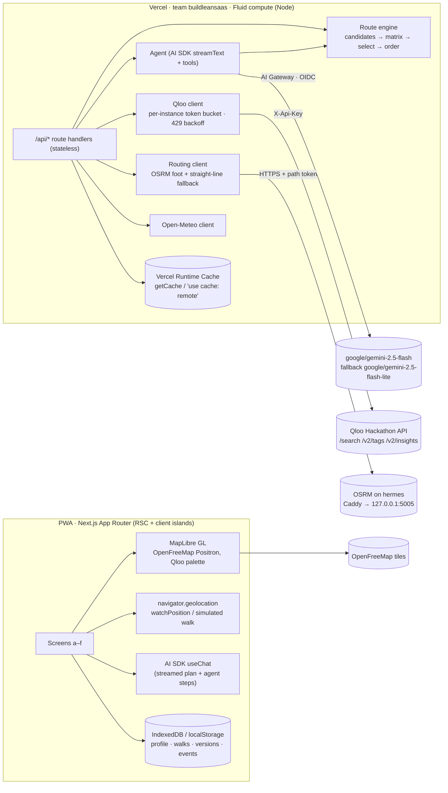

# taste-quest: build plan (v2, lean stack)

**Deadline:** Fri **Oct 30 2026, 11:45 PM ET**. Our internal submit target is **Thu Oct 29, 9 PM ET**.
**Written:** Mon Oct 19, 4:50 PM ET. **v2 (lean stack):** Mon Oct 19, ~5:30 PM ET, after Austin's answers. Builds on design iteration 1 (`/workspace/taste-quest-design`).
**One-liner:** a Pokémon Go-style taste explorer. You pick tastes, say how long you have, and get a live walking route through places ranked by Qloo affinity. Every stop says why it fits you, and the route re-plans as you walk.

---

## 0. Verified facts (live probes, Oct 19, hackathon environment)

| Question | Result | What it means for the build |
|---|---|---|
| Base URL and auth | `https://hackathon.api.qloo.com`, header `X-Api-Key` | Use as documented. |
| **Rate limits** (from response headers) | `x-second-ratelimit-limit: 5`, `x-month-ratelimit-limit: 10000`. 7 parallel calls returned **3× 429**. | **10k calls/month is the binding limit.** We need a server-side token bucket (≤4 req/s), aggressive caching, and a quota meter. Ask Qloo Discord #api-help for a raise. |
| Latency | insights 0.15–0.6 s, tags 0.12–0.65 s, search ~0.16 s | We can fan out 2–3 Qloo calls per plan and stay under 2 s total. |
| `filter.location=POINT(lon lat)` + `filter.location.radius` | Works. At r=800 m, 50 results, max distance 748 m, median 442 m. | The radius is a hard cap. Use it as the walk catchment. |
| Coordinates | `entity.location.{lat,lon,geohash}` | Pins come straight from the API. |
| Rich place fields | `properties.{address, short_description, description, hours, is_closed, price_level, neighborhood, image.url, images, business_rating, live_music, good_for, …}`, plus `tags[]` (about 74 per place, each with `id/name/type`), `popularity`, and `external.google_place` | We get descriptions and photos (images.qloo.com), so the LLM never needs to invent facts. |
| `filter.hours=tuesday` | Works. Places closed that day are removed (0 closed in 50). | Filter by **day** only. Exact open/close times come from `properties.hours[day][].opens/closes` (`"T12:00:00"`), which we check ourselves. |
| `signal.interests.entities` over GET | Works with comma-separated UUIDs. | Default to GET. |
| **Weighted signals (POST)** | The docs' `{"entity":…}` shape **returns 400**. The format that works is `[{"id":"<uuid>","weight":30}]`, and `signal.interests.tags` takes `[{"tag":…,"weight":…}]`. | POST is only for weighted or group signals. Weights have a mild effect: 30:5 came out as a 0.56:0.44 share. |
| **Explainability** | Per result: `query.explainability["signal.interests.entities"] = [{entity_id, score}]`, where the scores **sum to 1** across the input entities. At top level: `effect_on_top{3,5,10,all}_recs[{entity_id, avg_score}]`. **Tag signals do not appear in explainability.** | "Why" chips show each entity's **share** (for example "Tame Impala 26%"), plus **tag overlap** we compute ourselves (the user's vibe and cuisine tags ∩ `entity.tags`). With one input entity the score is always 1, so we need at least 2 entity picks for the shares to mean anything. |
| `/v2/tags?filter.query=…&filter.parents.types=urn:entity:place` | Real IDs come back. Examples: natural wine → `urn:tag:cuisine:qloo:natural_wine`; live music → `urn:tag:category:place:live_music_venue` / `urn:tag:good_for:qloo:live_music`; tacos → `urn:tag:specialty_dish:place:tacos`; hidden gem → `urn:tag:ambience:qloo:hidden_gem`; dive bar → `urn:tag:decor:qloo:dive_bar`. | Several IDs per word. We keep a curated chip→tag map (tag IDs only, no Qloo response bodies, so it's safe to commit) and use live search for anything else. |
| Coverage | Austin r=1.2 km gives 50 results and page 2 gives 50 more. Lisbon r=1 km gives 50. **Marfa TX r=2 km gives only 21.** | Thin-coverage path: widen the radius in steps (800 → 1500 → 2500 m), then fall back to "not enough taste matches here, try the Austin demo". |

**Routing and tiles (terms checked):**
- **OpenFreeMap** public tiles are free, have no limits, allow commercial use, and require attribution (MapLibre adds it automatically). → **Use it in production.**
- **OSRM public demo servers** are for "reasonable, non-commercial use, ≤1 req/s, no guarantees", so we never use them in production.
- **v2 decision:** we **self-host OSRM** (`foot` profile, Austin-metro extract) on Austin's VPS **hermes**, behind its existing Caddy over HTTPS, with a path token. No third-party routing account and no quota. openrouteservice is dropped. The setup and verification are recorded in §3.6.

---

## 1. Architecture



**Outside services (v2):**
- Qloo (required)
- Vercel: hosting, AI Gateway and Runtime Cache, all on one account
- OpenFreeMap tiles (keyless)
- Open-Meteo (keyless)
- OSRM on hermes (Austin's own box)

There's **no database, no Redis, no auth provider and no routing SaaS.**

### Locked stack decisions

| Layer | Decision | Why |
|---|---|---|
| App | **Next.js 15 App Router + TypeScript + Tailwind v4**, using `docs/design/tokens.css` as the Tailwind theme | Matches Vercel, server routes, and RSC for the static parts. |
| Hosting | **Vercel, team `buildleansaas`** (`team_Hvje1GDcwz5w6S7InmgjhLVN`), project `taste-quest` → **https://taste-quest.vercel.app**. Node runtime, Fluid compute. Plan routes set `maxDuration = 60`, and the plan budget is p95 < 8 s. | Austin's account, zero-ops, good for streaming. |
| Map | **MapLibre GL JS 4 + OpenFreeMap Positron**, recoloured at runtime to the Qloo palette. 3D buildings at 0.45× height. | Free, no key, commercial use OK, proven in the mockups. |
| Routing | **Self-hosted OSRM v6 (`foot.lua`, MLD) on hermes**, reached at `https://osrm-tq.76-13-113-185.sslip.io/<token>/route/v1/foot/…`. **Local walk matrix**: haversine × 1.3 at the chosen pace. **Fallback** is straight dashed segments with the label "approx." | No quota, no account, about 1 call per plan. It's served by Austin's own box. |
| Auth | **None. Guest mode only.** No accounts and no cookies beyond what Next needs. An anonymous `deviceId` (UUID in localStorage) is sent only as a rate-limit and analytics hint. | Austin's call. It also removes the judges' sign-in wall. |
| State | **In the browser:** IndexedDB via `idb-keyval` for profile, walks, walk versions and an event log. A localStorage mirror holds the active walk ID. **The server is stateless.** The client sends the profile with each request. | No DB service. Survives reloads and offline use. |
| Server cache | **Vercel Runtime Cache** (`getCache()` from `@vercel/functions`, plus `'use cache: remote'` for pure fetchers). Regional, TTL-based, max 2 MB per item, tags for purging. | Built in, no extra service. See §3.3 for why it's enough for the throttle and quota meter. |
| LLM | **Vercel AI SDK v5** via **AI Gateway with OIDC**. There's no `AI_GATEWAY_API_KEY` in production, because the AI SDK uses `VERCEL_OIDC_TOKEN` automatically on Vercel. Locally, `vercel env pull` brings in a short-lived OIDC token. Primary model `google/gemini-2.5-flash`, fallback `google/gemini-2.5-flash-lite`. | One account, spend controls, no keys to manage. |
| Weather | **Open-Meteo** (keyless, non-commercial tier, which fits a hackathon) | Indoor swaps when it rains. |
| PWA | `app/manifest.ts` + Serwist service worker | Install prompt and offline mid-walk. |
| Testing | Vitest (engine, Qloo client with synthetic fixtures), Playwright (mobile e2e on the demo), Lighthouse | — |
| Observability | Vercel Observability + Analytics custom events (`track('plan_ok')`, …), Speed Insights, AI Gateway logs, structured `console` JSON logs with `x-qloo-request-id` | No events DB. |

**What not to do:** never commit Qloo response data. Fixtures are **synthetic**. Real responses live only in the Runtime Cache and in the user's own browser. `research/` and `vendor/` are never committed.

---

## 2. Screens

Shared client state is a Zustand store, persisted to `localStorage` for walk resilience:
- `profile {entities[], tags[], updatedAt}`
- `budget {minutes, mode: '1h'|'2h'|'tonight'|'allday', pace, shape: 'loop'|'one-way'|'end-near'}`
- `start {lat, lon, label, source: 'gps'|'pin'|'demo'}`
- `walk {id, stops[], route, cursor, skipped[], visited[], remainingMin}`
- `geo {status, fix, accuracy, heading}`
- `net {online}`

### a) Welcome / sign-in
- **Components:**
  - `AuroraHero` (CSS-only gradient)
  - floating `GeoChip`s (from the demo profile)
  - `Button` variants: **"Try the Austin demo"** (primary) and **"Start exploring"** (secondary). **No sign-in buttons**; the mockup's Apple and Google buttons are removed.
  - `QlooCredit`
- **States:**
  - default
  - signing in (button spinner)
  - storage unavailable (Safari private mode with IndexedDB blocked) → in-memory store plus the note "Your walk won't be saved on this device"
  - offline (the demo button still works from the cached shell)
- **APIs:** none. On first load, generate a `deviceId`. If IndexedDB already has a profile or an active walk, resume.
- **Qloo:** none.
- **Edge cases:**
  - If a returning user has an active walk, go straight to (d).
  - A returning user with a saved profile skips (b), with an "Edit tastes" link.
  - Clearing site data loses the walk history, which is expected for guest-only.

### b) Taste onboarding
- **Components:**
  - `TasteSearch` (combobox, 250 ms debounce, minimum 2 characters)
  - `ResultRow` with the "QLOO MATCHED" mono badge
  - `CategorySection` × 4 (Artists, Films & TV, Cuisines, Vibes)
  - `TasteChip` (selected = category wash)
  - progress bar
  - CTA "Continue · N picked", enabled when there are ≥ 2 **entity** picks and ≥ 3 picks in total
- **States:**
  - suggested chips (from the curated list) shown immediately
  - search loading (skeleton rows)
  - no match ("No exact match. Add as a vibe?", which runs a tag search)
  - Qloo 429 or error ("Search is busy, tap a suggestion"; suggestions keep working)
  - offline (search disabled, chips still work)
- **APIs:**
  - `GET /api/taste/search?q=&cat=` → Qloo `/search`
  - `GET /api/taste/tags?q=` → Qloo `/v2/tags`
  - The profile is saved to IndexedDB on the client. No server call.
- **Qloo params:**
  - Artists: `/search?query=…&types=urn:entity:artist&take=5`
  - Films & TV: `types=urn:entity:movie,urn:entity:tv_show`
  - Places as tastes ("a bar I love at home"): `types=urn:entity:place`
  - Vibes and cuisines: `/v2/tags?filter.query=…&filter.parents.types=urn:entity:place&take=8`, choosing by our priority order: `category:place` > `genre:place` > `cuisine:qloo` > `ambience:qloo` > `specialty_dish` > others
  - The curated chip→tag-ID map is in `lib/taste/curated.ts`.
- **Edge cases:**
  - Same-name entities (two "Khruangbin & Leon Bridges"): show the type and genre subtitle.
  - The user picks only vibes (tags): allow it, but warn that "why" will be tag-based, and add one popular seed entity per vibe chip ("Live music" → Khruangbin) so explainability has entities to split.

### c) Time budget and starting point
- **Components:**
  - `BudgetCard` × 4: 1 hr = 60, 2 hrs = 120, Tonight = until 00:00 local (minimum 90), All day = 480
  - `StartCard` (Near me toggle / Pick on map sheet)
  - `PaceChips`: Easy 4.0 km/h, Brisk 5.2 km/h, Step-free = OSRM `foot` with a post-filter that avoids `steps` (via the edge `classes`/annotations; the MVP shows a "may include steps" note)
  - `ShapeToggle`: **Loop** (default) or **One-way**. Loop starts at the origin (current location, or a pin such as a hotel), visits the stops, and ends back there. The engine also accepts `end-near` with a chosen finish point.
  - context line (open now · date · weather)
  - CTA "Build my route"
- **States:**
  - GPS prompting
  - GPS granted (reverse-label from the nearest Qloo `properties.address`, or plain coordinates)
  - **GPS denied** → "Near me" turns off, the map-pin picker opens, and "Use Austin demo start" is offered
  - low accuracy (> 150 m) → "Location is fuzzy" note, but still allowed
  - weather loading or failure → the line is simply hidden
- **APIs:** `GET /api/context?lat&lon` (Open-Meteo plus local time and the weekday for `filter.hours`).
- **Qloo:** none.
- **Edge cases:**
  - "Tonight" chosen after 11 PM → clamp to 60 min and say so.
  - Start point outside dense coverage → the plan route handles widening.

### d) Explore map (hero)
- **Components:**
  - `TasteMap` (MapLibre: pitch 42, bearing follows heading when walking)
  - `UserDot` (live-pulse, heading cone)
  - `StopPin` (numbered; next / new / skipped variants) and a home pin on the origin, in the same bubble-and-stem language
  - `RouteLine` (lilac with a white casing; dashed ghost after a re-route)
  - top `GeoChip`s (time left, stops done)
  - `NextStopSheet` (eyebrow, name, meta, 0.xx match, plum blurb, evidence chips, Skip / Go)
  - `AgentTicker` (streamed agent steps while planning: "Searching Qloo near Congress Ave…")
- **States:**
  - **planning** (skeleton sheet + streaming ticker + pins dropping in as stops are confirmed)
  - active walk
  - arrived (sheet → "You're here", with Next or Done)
  - **no results** ("Not enough taste matches within 2.5 km", with "Widen", "Change tastes" and "Try Austin demo")
  - **error** (retry, keeping the last good walk)
  - **offline** (keep the cached route and stops; Qloo-dependent actions are disabled; banner)
  - tiles failing (fall back to a plain land-colour background with the route and pins still drawn)
- **APIs:**
  - `POST /api/plan` (streamed)
  - `POST /api/walk/:id/event` (arrive, skip, go)
  - `POST /api/walk/:id/reroute`
- **Qloo:** handled inside `/api/plan` (see §3 and §4).
- **Other services:** OSRM on hermes (called from the server, so the token never reaches the client), OpenFreeMap (client).
- **Edge cases:**
  - GPS jitter: smooth the fix and require 2 consecutive off-route fixes.
  - The user walks the "wrong" way to a later stop: treat it as reordering and re-route.
  - The background tab kills `watchPosition`: on resume, recompute from the last fix.
  - The screen must not lock: use the Wake Lock API while walking, if supported.

### e) Stop detail
- **Components:**
  - `MapHeader` (290 px, focused on the stop)
  - `MatchRing` (affinity 0–1)
  - `FactsRow` (Open/closes from `properties.hours`, walk minutes, 1–2 Qloo tags)
  - `WhyBlock`: a plum paragraph, with "QLOO EXPLAINABILITY" mono label
  - `EvidenceRow` × ≤ 3: input entity, category, share bar, %
  - `TagOverlap` chips (your vibes ∩ place tags)
  - `PhotoStrip` from `properties.images` (if any)
  - Skip / Go
  - "Open in Google Maps" link (built from lat/lon; no Google API)
- **States:**
  - loading (the blurb streams in when it isn't cached)
  - no explainability (single-entity profile) → show tag-overlap evidence only, with the label "Matched on your vibes"
  - closing soon (< 45 min) warning
  - closed now → "Closed now", with Skip highlighted
- **APIs:** none in the normal case. The stop, its evidence and the blurb are already in the walk object in IndexedDB. `POST /api/blurb` runs only if the blurb is missing.
- **Edge cases:**
  - A long `short_description`: clamp it to 3 lines.
  - A missing image: use a tone tile in the category colour.

### f) Re-route moment
- **Components:**
  - `RerouteToast` (night card: title, diff sentence, Undo for 8 s)
  - ghost old route
  - `WalkTimeline` (visited / skipped / next / new / todo)
  - updated pins
- **States:**
  - re-routing (thin progress bar on the toast)
  - success
  - **undo** (restore the previous walk version)
  - re-route failure (keep the old route; toast "Couldn't update. Your route is unchanged.")
  - remaining time about equal to the walk home → "Time to head back · 14 min" and no new stops. The return leg is always recomputed. The walk list ends with "Back to start · N min". A "Ride back" row (Uber and Lyft universal links, origin as the dropoff, no API keys) shows when that walk is over about 20 minutes or it's late.
- **APIs:** `POST /api/reroute` (stateless: the client sends the walk, the cached-pool key and its fix) → returns `diff`, `stops` and `route`. **Undo is client-side**: restore the previous `walkVersion` from IndexedDB.
- **Qloo:** usually **0 calls** (the candidate pool is cached with the walk). A call happens only when the pool is exhausted or the user has drifted more than 600 m from the pool's centroid (then a new insights call at the current position).

---

## 3. Backend

### 3.1 API routes (all `app/api/**/route.ts`, Node runtime, zod-validated, stateless)

Every request carries `x-device-id` (rate-limit and analytics hint only). The profile and walk come from the client.

| Route | Request | Response |
|---|---|---|
| `GET /api/taste/search` | `?q=string&cat=artists|film|places` | `{results:[{id, name, type, subtitle, imageUrl?}]}` (trimmed) |
| `GET /api/taste/tags` | `?q=string` | `{results:[{id, name, type}]}` |
| `GET /api/context` | `?lat&lon` | `{localTime, weekday, tz, weather:{tempF, code, precipProbNext3h, isRainy}}` |
| `POST /api/plan` | `{profile:{entities[], tags[]}, start:{lat,lon}, budgetMin, pace, mode, shape?:'loop'\|'one-way'\|'end-near', end?:{lat,lon,label?}, demo?:boolean}` | **UI message stream:** `data-step` (agent ticker), `data-stop` ×N, `data-route` (GeoJSON + legs), final `data-walk` `{walkId (client may override), version:1, poolKey, stops[], route, totals, shape, returnMin}` |
| `POST /api/reroute` | `{profile, walk:{stops[], visited[], skipped[], vetoedTags[], startedAt, budgetMin, pace}, poolKey, fix:{lat,lon}, reason}` | `{diff:{removed[], added[], reordered, deltaMin}, stops[], route, toast}` |
| `POST /api/blurb` | `{profile, stop:{entityId, name, evidence}}` | `{blurb}` (only when one is missing) |
| `GET /api/demo` | — | the preset demo profile, walk and simulated GPS track (served from the Runtime Cache, warmed by cron) |
| `GET /api/health` | `Authorization: Bearer $ADMIN_TOKEN` | `{qlooMonthRemaining (last seen), qlooSeenAt, osrmOk, osrmMs}` |
| *(stretch)* `POST /api/mcp` | MCP Streamable HTTP | tools `plan_walk`, `reroute_walk` |

### 3.2 Qloo client (`lib/qloo/`)
- `qlooFetch(path, params, {method, cacheKey, ttl})`:
  - Adds `X-Api-Key`.
  - Passes through an **in-process token bucket** (4 req/s per instance) and a **concurrency cap of 3**.
  - On **429**, retries with backoff (250, 500, 1000 ms + jitter), honouring `x-second-ratelimit-reset`, then fails soft.
  - Logs `x-qloo-request-id` and latency.
  - Writes `{remaining: x-month-ratelimit-remaining, at}` to the Runtime Cache key `qloo:quota` (TTL 1 h, last write wins).
  - **Quota guard**, using the last-seen value:
    - Below 1,500 remaining, live taste search is limited to curated chips only.
    - Below 500, new plans are served only for the demo or cache hits, with a banner.
- `search`, `tags` and `placesNear`: same params as v1:
  - `filter.type=urn:entity:place`
  - `filter.location=POINT(lon lat)`
  - `filter.location.radius`
  - `signal.interests.entities`
  - `signal.interests.tags`
  - `filter.hours=<weekday>`
  - `feature.explainability=true`
  - `filter.exclude.tags=<denylist>`
  - `bias.quality=low`
  - `take=50`
  - POST with `[{"id","weight"}]` only for weighted or group signals.
- **Normalizer** → trimmed `Candidate` objects, about 1–2 KB each, so a pool of 100 is about 150 KB, well under the 2 MB Runtime Cache item limit.

### 3.3 Caching: Vercel Runtime Cache only

| Key | Contents | TTL |
|---|---|---|
| `qs:{type}:{q}` | trimmed search results | 7 d |
| `qt:{q}` | tag results | 14 d |
| `qp:{sha(entities,tags)}:{geohash6}:{radius}:{weekday}` (= `poolKey`) | normalized candidates (≤ 100) | 24 h |
| `osrm:{sha(coords)}` | route GeoJSON + legs | 7 d |
| `wx:{geohash5}` | weather | 30 min |
| `blurb:{entityId}:{sha(profile)}` | LLM "why" paragraph | 7 d |
| `demo:v1` | demo profile, candidates, route and track | 30 d. Re-warmed by Vercel Cron → `/api/cron/warm-demo` daily and on deploy. |
| `qloo:quota` | last-seen month-remaining | 1 h |

Reroutes read `poolKey` from the cache. On a miss (different region, or the entry was evicted), we refetch at most once. The client also keeps the trimmed pool for the active walk in IndexedDB and **sends it back** when it's ≤ 150 KB, so a reroute normally costs no Qloo call even on a cache miss.

**Is the Runtime Cache enough for the throttle and the quota meter? Yes, for this app:**
- **Quota meter:** Qloo reports the authoritative `x-month-ratelimit-remaining` on every response. We just store the latest value. No shared counter is needed, and a few minutes of staleness doesn't matter at a threshold of 500 or 1,500.
- **5 req/s throttle:** Fluid compute reuses warm instances, so an in-process bucket covers most traffic. Our app-level ceiling is 3 Qloo calls per plan, and the 429 backoff covers the rest. Hackathon traffic is low, typically one or two concurrent judges. Runtime Cache has no atomic increment and is regional, so it **can't** implement an exact global token bucket, and we don't need one.
- **If we ever truly need a shared counter** (for example a public launch with real concurrency), use **Vercel Edge Config only for config flags**; it isn't for high-write counters. For counters, the simplest Vercel-native option is a **Marketplace Redis (Upstash) attached in one click**. That's **out of scope** for the hackathon and noted as the upgrade path.

Starting points are snapped to **geohash-6** so nearby users share cached candidates.

### 3.4 Rate limits (ours, best-effort, per instance)
- In-memory sliding window keyed by `x-device-id` + IP: plans 10/hour, reroutes 60/hour, taste search 60/min.
- Global circuit breaker: when the last-seen quota is below 500, only the demo and cache hits are served.
- Vercel Firewall rate-limit rule on `/api/plan` (30/min per IP), configured in the dashboard with no code.

### 3.5 Env vars (Vercel encrypted; `.env.example` in the repo without values)
- `QLOO_API_KEY`, `QLOO_API_URL=https://hackathon.api.qloo.com`
- `OSRM_URL=https://osrm-tq.76-13-113-185.sslip.io`, `OSRM_TOKEN` (path token)
- `AI_MODEL=google/gemini-2.5-flash`, `AI_FALLBACK_MODEL=google/gemini-2.5-flash-lite`. **No AI key in production (OIDC).** Locally, run `vercel env pull` for `VERCEL_OIDC_TOKEN`.
- `ADMIN_TOKEN`, `CRON_SECRET`

### 3.6 OSRM on hermes (self-hosted routing)
- **Data:** Geofabrik `texas-latest.osm.pbf`, clipped with osmium to the Austin metro bbox `-98.25,29.95,-97.35,30.75`, then `osrm-extract -p /opt/foot.lua` → `osrm-partition` → `osrm-customize` (MLD).
- **Container:** `osrm-tq` (`ghcr.io/project-osrm/osrm-backend:v6.0.0`), `osrm-routed --algorithm mld --max-table-size 200`, bound to **127.0.0.1:5005** only, `restart: unless-stopped`, memory limit 1 GB.
- **Caddy** (existing container, host network): a new site block `osrm-tq.76-13-113-185.sslip.io`, which gets an automatic Let's Encrypt certificate.
  - Only `/<token>/*` is proxied, with the prefix stripped.
  - Everything else returns 404.
  - CORS is not enabled, because the browser never calls it.
  - Other site blocks (ScaleSleek, media) are untouched, and the config is validated before reload.
- **Verified Oct 19, ~5:10 PM ET:**
  - From outside, a 4-stop downtown Austin walk returned `200` in 0.19 s: 1,398 m, legs of 351/404/249 s, 96-point GeoJSON.
  - Without the token, or with a wrong one, the response is `404`.
  - `osrm-routed` uses about **335 MiB** RAM (1 GiB cap). The data is 592 MB on disk.
  - hermes had about 11 GB available before and after.
- **Caddy fix (side effect, needed for HTTPS):**
  - The existing `caddy` container had been **crash-looping for about 13 days** (3,059 restarts), because `tailscaled` (tailscale serve for Postiz) holds `:443` on the tailnet IP, and Caddy was binding `:443` on all interfaces.
  - Added the global option `default_bind 76.13.113.185 [2a02:4780:4:5d09::1]` so Caddy binds only the public IPs.
  - Caddy is now up, and `api.scalesleek.com` and `media.allthecalculations.com` are reachable again.
  - Tailscale serve (Postiz) is untouched.
  - Backups are at `/root/work/services/caddy/Caddyfile.bak-*`.
- **Ops:** refresh the extract weekly with a cron script (`/root/work/services/osrm/refresh.sh`) only if needed. For the hackathon, a one-time extract is fine.

## 4. Route engine (`lib/engine/`, pure TS, unit-tested)

1. **Candidate fetch.**
   - Radius `r = clamp(walkSpeed × budgetMin × 0.35, 600, 2500)` m. That's roughly the reach of a loop where about a third of the time is spent walking.
   - Call `placesNear` (page 1). If fewer than 25 usable candidates remain after filtering, fetch page 2 or widen r in steps (×1.6, at most 2 more calls).
   - **Filter:**
     - drop `is_closed` places and places closed at the ETA (worked out from `hours`)
     - drop the category denylist
     - drop anything already visited or skipped
     - drop duplicate addresses (for example "ACL Live" and "3Ten ACL Live", both at 310 W Willie Nelson Blvd, keeping the one with the higher affinity)
     - drop places within 40 m of each other unless they are different categories
2. **Scoring.**
   - `score = affinityNorm^1.5 × (1 + 0.15 × tagOverlapCount) × diversityPenalty`
   - `affinityNorm` rescales the pool's min–max to 0–1, because raw affinities cluster at 0.83–0.88.
   - The diversity penalty multiplies by 0.6 for each earlier pick in the same primary category.
   - Context: with rain, outdoor tags (park, trail, rooftop) × 0.3. In the evening, boost `good_for` evening/nightlife tags.
3. **Walk matrix.**
   - `minutes(i,j) = haversine × 1.3 / speed`, for N ≤ 40 top-scored candidates plus the start.
   - Done locally in < 1 ms. The OSRM `table` service (on hermes) is available for refinement later, but isn't used in the MVP.
4. **Dwell time** per category: café 20, bar 35, live music 45, museum 50, park 15, restaurant 60, default 25. Easy pace adds 10%.
5. **Selection (orienteering heuristic).**
   - Greedy insertion by the ratio `score / (Δwalk + dwell)`, inserting each candidate at its cheapest position in the current sequence, until no candidate fits.
   - Constraint: `Σwalk + Σdwell ≤ budget − 5 min slack`. On a loop or an end-near walk, the walk back to the finish is inside that sum. There is no dwell on the closing leg.
   - Then **2-opt** on the order (on the cycle, when the walk closes) and a **swap pass**: try replacing each chosen stop with an unchosen one if total score rises and the route still fits.
   - **Shape**, default `loop`:
     - `loop` finishes at the origin. Prefer a loop over an out-and-back: the farthest stop lands roughly in the middle, and a return that retraces an outbound street loses to a near-equal alternative.
     - `one-way` is an open path from the start.
     - `end-near` finishes at a chosen point.
   - **Order** is not nearest-neighbor. Each category has a time-of-day fit: coffee or breakfast early, sights, museums and shops in the daytime, dinner around 5:30–9pm, live music, bars and nightlife in the evening, dessert or a nightcap last and close to the origin. At most one full meal per meal window (breakfast before 11, lunch 11–3, dinner 5:30–9), and meals stay about 90 minutes apart. A stop has to be open at the estimated arrival and through its dwell (`filter.hours`). The insertion ratio scores affinity, time-of-day fit and walking cost together. The reason can show up in the blurb ("Dinner while kitchens are open.").
   - Target stop counts: 1 h → 2–3, 2 h → 4, tonight → 4–5, all day → 6–8 (cap 8).
6. **Directions.**
   - One OSRM `route/v1/foot` call with all waypoints (`overview=full&geometries=geojson`) → GeoJSON plus per-leg durations. A loop or end-near walk appends the finish as the last waypoint. OSRM's foot profile is slow (about 4.4 km/h), so scale leg durations by `paceFactor`.
   - Replace matrix estimates with the real leg times. If the total now exceeds the budget by more than 5%, drop the lowest-ratio stop and call again (at most once).
   - **Fallback** if OSRM fails or takes over 2 s: draw straight dashed segments with estimated minutes and the label "approx."
7. **Re-route triggers.**
   - `offroute`: distance from the route polyline > 60 m for 2 consecutive fixes, accuracy < 50 m.
   - `skip` / `veto`: the user taps it. A veto also adds the place's primary category to `filter.exclude.tags` for this walk.
   - `late`: at an arrival, actual time is more than 10 min behind plan.
   - `closed`: the next stop closes before the ETA.
   - `weather`: precipitation probability in the next hour goes above 60% while an outdoor stop is next.
   - **Debounce:** at most 1 automatic re-route every 90 s. Manual triggers are immediate.
8. **Re-route logic.**
   - Remaining budget = budget − elapsed, and it still has to cover the walk back. Keep visited stops.
   - Re-run selection from the current fix using the **cached pool** (minus skipped stops). Bias toward keeping already-planned stops with a ×1.2 stability bonus, so the route doesn't churn. Always recompute the return leg.
   - When the time left is about the walk home (within about 8 minutes), stop offering new stops and return "Time to head back · N min".
   - Diff old and new versions (`added`, `removed`, `reordered`, `deltaMin`). The agent writes a one-line toast from that diff.
   - The client saves it as a new `walkVersion` in IndexedDB so Undo can restore it.

---

## 5. The agent

The engine is deterministic. The agent orchestrates it and explains it. It never invents stops.

- **Tools** (AI SDK `tool()` with zod schemas):
  1. `get_context(lat, lon)` → time, weekday, weather
  2. `find_candidates(lat, lon, radiusM, emphasisTags?)` → top 40 trimmed candidates (id, name, category, affinity, tags top 8, shares)
  3. `build_route(candidateIds?, budgetMin, pace, mustInclude?, exclude?)` → selected stops, legs and totals. The engine validates everything; unknown IDs are rejected.
  4. `explain_stop(entityId)` → the evidence bundle: shares by input-entity name, tag overlap, short description, hours
  5. `reroute(reason, fix)` → diff
- **Flow for `/api/plan`:**
  - Step 1: `get_context` and `find_candidates` in parallel.
  - Step 2: `build_route`. The agent may pass `emphasisTags` (for example "it's raining → indoor") or `mustInclude` (for example the top match).
  - Step 3: `explain_stop` × N, in parallel.
  - Step 4: final structured output with a `blurb` (≤ 2 sentences) per stop.
  - Limits: `stopWhen: stepCountIs(6)`, a 20 s overall timeout, and the deterministic engine result as fallback if the LLM fails (the blurb falls back to a template).
- **System prompt outline:**
  - Role: a local friend who knows your taste.
  - Hard rules:
    - Only mention places returned by tools, using their exact names.
    - Only cite evidence present in `explain_stop`, meaning entity shares and tag overlap.
    - Never claim facts that aren't in the tool output: hours, prices, history, awards.
    - No personal inferences. Phrase it as "people who love X tend to love this" (Qloo's aggregate-affinity guidance).
    - Style: ≤ 2 sentences, concrete, no superlatives.
    - Give the output schema.
- **Streaming:** `streamText` → `toUIMessageStreamResponse()`, with custom `data-step`, `data-stop` and `data-route` parts written via `createUIMessageStream`. The client renders the ticker and drops pins as `data-stop` arrives. The sheet fills when `data-walk` completes.
- **Grounding:**
  - Evidence chips are rendered **from data, not from LLM text**: `entityShares` sorted descending, top 3, as "Because you like {name} · {share%}".
  - The paragraph is the only free text, and it gets checked.
  - **Hallucination guard:** after generation, extract proper nouns and quoted names. Every place name must equal a tool-returned `name`, and every "because" entity must be in the profile. If either check fails, regenerate once, then use the template: "People who love {top entity} and {top tag} tend to love {place}. {short_description first clause}".
- **Cost per plan** (gpt-5-mini via Gateway, at about $0.25/M input and $2/M output; confirm on the Gateway pricing page):
  - Tokens: about 6k input (tools plus results, trimmed) and 1.2k output → about **$0.004 per plan**, and about $0.0005 per re-route toast.
  - Qloo calls per plan: 1–3. OSRM calls: 1–2 (self-hosted, free).
  - Budget: a $15 Gateway spend cap covers more than 3,000 plans.

---

## 6. Data model (client-side, IndexedDB via `idb-keyval`, versioned schema)

```ts
// key 'tq:v1:device'        -> { deviceId: string, createdAt: string }
// key 'tq:v1:profile'       -> TasteProfile
type TasteProfile = { entities: {id: string; name: string; type: 'artist'|'movie'|'tv_show'|'place'; weight?: number}[];
                      tags: {id: string; name: string; cat: 'cuisine'|'vibe'}[]; updatedAt: string };
// key 'tq:v1:walks'         -> WalkSummary[]  (index: id, status, startedAt, city)
// key 'tq:v1:walk:<id>'     -> Walk
type Walk = { id: string; status: 'planning'|'active'|'done'|'abandoned'; mode: string; budgetMin: number; pace: 'easy'|'brisk'|'stepfree';
              shape?: 'loop'|'one-way'|'end-near'; end?: {lat: number; lon: number; label?: string}; returnMin?: number; headingBack?: boolean;
              start: {lat: number; lon: number; label?: string}; isDemo: boolean; poolKey: string; pool?: Candidate[]; // trimmed, active walk only
              currentVersion: number; versions: WalkVersion[]; startedAt?: string; endedAt?: string };
type WalkVersion = { version: number; reason: 'initial'|'offroute'|'skip'|'veto'|'late'|'closed'|'weather'; createdAt: string;
                     route: GeoJSON.LineString; totals: {walkMin: number; dwellMin: number; km: number}; stops: Stop[] };
type Stop = { seq: number; entityId: string; name: string; lat: number; lon: number; affinity: number; etaMin: number; dwellMin: number;
              state: 'todo'|'next'|'visited'|'skipped'|'vetoed'; evidence: {entityShares: {entityId: string; name: string; share: number}[];
              tagOverlap: {id: string; name: string}[]}; blurb?: string; hours?: unknown; imageUrl?: string };
// key 'tq:v1:events'        -> ring buffer (last 500) of {type, walkId?, payload, at}  // also mirrored to Vercel Analytics track()
```

- **Data minimisation:** the browser stores only what the walk needs. When a walk ends, its `pool` is deleted. Nothing about the user is stored server-side.
- **Schema versioning:** the key prefix is `tq:v1`. Migrations run on load.
- **Export or reset:** a "Clear my data" item in the menu.

---

## 7. Guest / demo mode and PWA

- **Austin demo** ("Try the Austin demo" on the welcome screen, and the `/demo` URL for judges):
  - Preset profile: Khruangbin, Tame Impala, Leon Bridges, The Grand Budapest Hotel + tacos, natural wine, live music, hidden gems.
  - Start at Congress Ave & W 6th St, 2 hrs, Saturday 7 PM local time (a "demo clock", so `filter.hours` and the "open" labels are stable).
  - Data comes from the Runtime Cache key `demo:v1`, warmed by the Vercel Cron route `/api/cron/warm-demo` (a few Qloo calls per day), so it costs **0 Qloo calls per judge**. If the cache is cold, the request warms it inline once.
- **Simulated walk:**
  - A play/pause scrubber with 1×/10×/30× speed moves a virtual `UserDot` along the OSRM polyline.
  - It fires arrive events automatically.
  - At stop 2 it suggests "Try skipping this one" (a coach mark), so judges see re-routing within about 60 s.
  - The simulation uses the same engine and APIs as real GPS. Only the `geo` source differs (`GeoSource` interface: `RealGeo` / `SimGeo`).
- **"Try your own city":** in the demo, a pin-drop anywhere runs a real plan, quota permitting. Known-good presets: Lisbon, NYC LES, Mexico City Roma Norte.
- **PWA:**
  - `manifest.ts`: name "taste quest", `display: standalone`, theme `#f8f6f4`, icons from the mark.
  - Serwist SW: precache the shell, cache-first for `/assets`, stale-while-revalidate for OpenFreeMap tiles (max 300 tiles, per their offline rules: ≤ 50 MB, unique User-Agent N/A in browser), network-first for `/api/walk/*`.
  - An iOS "Add to Home Screen" hint sheet after the first completed plan.

---

## 8. Stretch items

| Item | Scope | Notes |
|---|---|---|
| Weather-aware swaps | **IN** (small) | Open-Meteo `get_context`, with indoor bias in scoring and the `weather` trigger. |
| Remote MCP endpoint (`/api/mcp`, tools `plan_walk`, `reroute_walk`) | **IN if green by Tue Oct 27** | About 0.5 day with `mcp-handler`. Strengthens the "agentic tool" story; README snippet for Claude Code. |
| Explore-with-friends (group overlap) | **OUT of v1 → "lite" only if we're ahead on Oct 28** | Lite version: add a second preset profile, POST weighted union, per-person share chips. The full version needs invites and sync, which is out. |
| Multi-day trips | **OUT** | Mention it in the Devpost "what's next". |
| Voice / realtime | **OUT** | — |
| Native apps | **OUT** | The PWA covers it. |

---

## 9. Testing, QA, observability, submission

- **Unit (Vitest):**
  - engine: selection respects the budget including the walk home, 2-opt never lengthens an open route, loop closure, time-of-day order, one meal per window, hours through the dwell, re-route stability, hours parsing across midnight, dedupe
  - Qloo normalizer, on synthetic fixtures
  - tag priority picker
  - hallucination guard
- **Contract tests (manual script, not CI):** `scripts/probe-qloo.ts` re-checks the response shapes from §0 against the live API (about 6 calls). Run it before each deploy day.
- **E2E (Playwright, iPhone 13 viewport):**
  - welcome → demo → plan streams → simulate → skip → toast → undo
  - guest onboarding with mocked Qloo
  - GPS denied
  - offline mid-walk (`context.setOffline`)
- **Device QA:** real iPhone Safari and Android Chrome; PWA install; a physical walk in any city, plus Austin if possible.
- **Performance:** LCP < 2.5 s on 4G (the map is lazy), plan p95 < 8 s, re-route p95 < 2 s. Lighthouse PWA ≥ 90.
- **Observability:**
  - Vercel Analytics / Speed Insights
  - AI Gateway dashboard (cost, latency, errors)
  - Vercel Analytics custom events (`plan_ok`, `plan_fail`, `skip`, `reroute`, `demo_start`) plus `/api/health` (Qloo quota last seen, OSRM status)
  - an alert in logs when Qloo remaining drops below 2,000
- **Submission checklist (Devpost):**
  - [ ] Live public URL (`https://taste-quest.vercel.app` or a custom domain), working end-to-end **without sign-in** (the demo)
  - [ ] Public repo `buildleansaas/taste-quest` with all source, README setup steps and `.env.example`
  - [ ] **MIT license visible in About** (already true)
  - [ ] No Qloo response data in the repo (CI grep for `images.qloo.com` / UUID-heavy JSON in fixtures)
  - [ ] Devpost text: what it does, how it's agentic (tools, re-plan loop), **"Why Qloo is essential"**:
    - cross-domain taste (artists/films → bars/museums)
    - explainability-grounded "why"
    - hours and location filters
    - the side-by-side "LLM-only vs Qloo" comparison: run an LLM with no tools on the same prompt and show that it picks generic tourist spots or hallucinated places
  - [ ] Screenshots (from design PNGs and real captures), built with list, judge instructions ("Tap *Try the Austin demo* → ▶ Simulate → Skip stop 2")
  - [ ] Attributions: OpenStreetMap contributors (ODbL), OpenFreeMap / OpenMapTiles, OSRM, Open-Meteo, Qloo
  - [ ] Submitted by Thu Oct 29 at 9 PM ET, then re-verified on Fri

---

## 10. Schedule (ET), mapped to issues

| Day | Work | Issues |
|---|---|---|
| **Mon Oct 19** (eve) | Plan v2 (lean). Close #1. Design docs committed. OSRM on hermes is live and verified. Vercel team confirmed. Austin posts the Qloo quota-raise request in Discord. | #1 ✅, #13 (infrastructure part) |
| **Tue Oct 20** | Scaffold Next.js + Tailwind tokens + design-system components. Create the Vercel project `taste-quest` on `buildleansaas` and link the repo. Env vars. Check OIDC → AI Gateway with a hello-world `generateText`. Set up the IndexedDB store. First preview deploy. | #2, #11 |
| **Wed Oct 21** | Qloo client: in-process bucket, 429 backoff, quota meter, normalizer, Runtime Cache wrappers, synthetic fixtures, probe script. Taste search and tags routes. | #3, #12 |
| **Thu Oct 22** | Screens a, b, c (no sign-in; curated chips + live search; time/start + `/api/context`; GPS states) | #4 |
| **Fri Oct 23** | TasteMap (MapLibre + palette, pins, user dot, GeoSource Real/Sim). Engine part 1: candidates, filters, scoring, matrix, selection + unit tests. | #5, #6 |
| **Sat Oct 24** | Engine part 2: 2-opt/swap. OSRM routing client + fallback. `/api/plan` working end-to-end without the LLM. Walk saved to IndexedDB. | #6, #13 |
| **Sun Oct 25** | Agent: tools, streaming ticker, explain_stop, blurbs, hallucination guard, stop detail (e) | #7 |
| **Mon Oct 26** | Re-routing: triggers, stability, diff + toast, client-side undo, timeline (f). Simulated walk. | #8 |
| **Tue Oct 27** | Demo mode + warm-demo cron. PWA (manifest, SW, offline). Weather trigger. **Feature freeze at 11 PM.** MCP endpoint only if everything is green. | #14, #15, (#17) |
| **Wed Oct 28** | QA day: Playwright e2e, real devices, performance, error states, copy polish. Friends-lite only if QA is green by 6 PM. | #16, (#9) |
| **Thu Oct 29** | README, Devpost write-up + "LLM-only vs Qloo" comparison, screenshots, judge instructions. **Submit by 9 PM.** | #10 |
| **Fri Oct 30** | **Buffer.** Fixes only. Re-test the live URL, the demo and OSRM health. Final Devpost edit before **11:45 PM** (target done by 6 PM). | — |

### Issues added for v2 (created Oct 19, on Ship Board #4)
- **#11** 🎨 Port design system
- **#12** 🧮 Qloo quota guard + Runtime Cache layer
- **#13** 🚶 Routing client: OSRM on hermes + straight-line fallback
- **#14** 🎬 Judge demo mode + simulated walk
- **#15** 📲 PWA + offline
- **#16** 🧪 QA + observability
- **#17** *(stretch)* 🔌 Remote MCP endpoint
- **#9** rescoped to friends-lite (stretch)

---

## 11. Risks and mitigations

| Risk | Likelihood / impact | Mitigation |
|---|---|---|
| **Qloo 10k/month quota** burned by dev + judges | High / high | Runtime Cache + geohash snapping, the pool sent back from the client, a demo that uses 0 calls, curated chips, a quota guard with degraded modes, Discord raise request |
| Qloo 5 rps limit → 429 | Medium / medium | Per-instance bucket, concurrency cap of 3, ≤ 3 calls per plan, backoff honouring the reset header |
| Runtime Cache is regional and evictable (a miss means a refetch) | Medium / low | The client keeps the pool in IndexedDB and sends it on reroute. One region for functions (`iad1`). Demo warmed by cron. |
| **hermes is a single point of failure for routing** (reboot, OOM, Caddy change) | Low-medium / medium | Straight-line fallback, `restart: unless-stopped`, a 1 GB memory cap so OSRM can't starve Postiz and the other services, `/api/health` check, 7-day route cache, the demo route pre-cached |
| OSRM coverage only covers the Austin metro | High (by design) / medium | Clearly labelled: outside Austin, routes are "approx." (straight-line fallback), while the Qloo recommendations still work worldwide. Expanding later means a larger extract (Texas or the US South) if RAM allows. |
| The path token leaks (for example in logs) | Low / low | It's only used server-side. Rotate by editing the Caddyfile + env. The worst case is someone else using a free router. |
| No auth means profile and walks are lost if site data is cleared | Medium / low | Expected for guest-only; noted in the UI. The demo always works. |
| Explainability is uninformative (one entity → 100%) | Medium / medium | Require ≥ 2 entity picks, seed entities for vibe-only profiles, tag overlap |
| Raw affinities clustered (0.83–0.88) | High / low | **Locked:** show the raw affinity to 2 decimals plus a rank label. Normalize only internally. |
| Odd candidates (nail salons, parking, hotels) | High / medium | `filter.exclude.tags` denylist + post-filter |
| LLM hallucinated places | Medium / high | Tool-only facts, post-check, template fallback; chips rendered from data |
| AI Gateway OIDC misconfigured locally | Low / low | `vercel env pull` refreshes the token. An API key is allowed for local dev only. |
| Scope creep | Medium / high | Freeze on Tue Oct 27 at 11 PM; stretch items gated on green QA |
| Qloo data accidentally committed | Low / high | Synthetic fixtures, `.gitignore`, CI grep for `images.qloo.com` and Qloo-shaped JSON |

## 12. Decisions (resolved Oct 19) and remaining questions

**Resolved:**
- Host on Vercel team **buildleansaas** at `taste-quest.vercel.app`.
- **Guest-only** (no Google or Apple sign-in).
- Lean stack: no Neon, no Upstash, no openrouteservice.
- AI Gateway via OIDC.
- OSRM self-hosted on hermes.

**Still open (only these need Austin):**
1. **Qloo quota raise:** post in Discord #api-help, since it's tied to his key.
2. **AI Gateway spend:** confirm a monthly budget cap (suggested $15) in the Vercel dashboard. This can't be set via the API we have.
